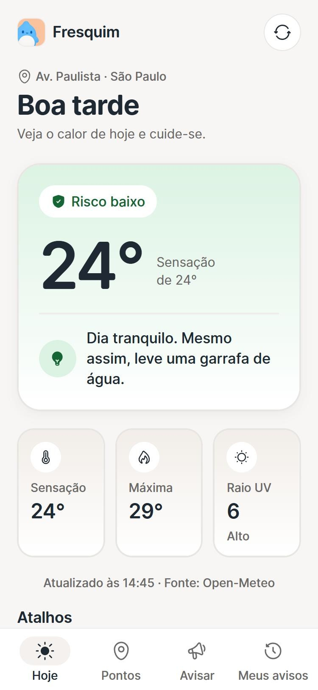
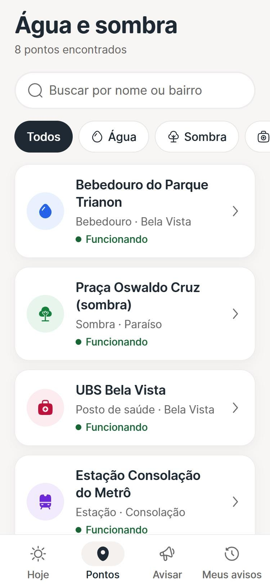
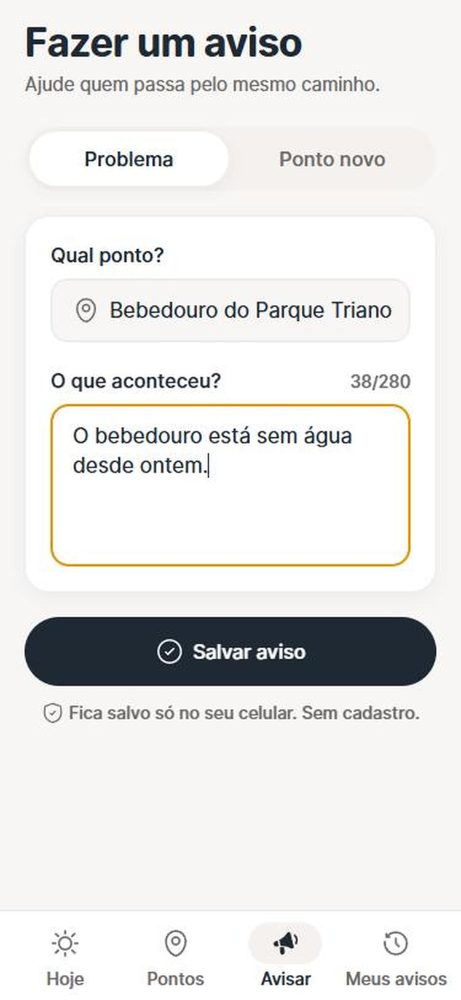
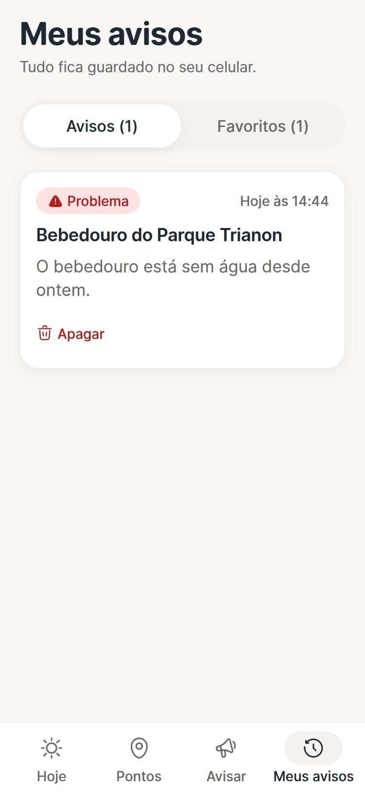

<p align="center">
  
</p>

<h1 align="center">Fresquim</h1>

<p align="center">GS 2026.2 · CitizenTech · Mobile Development &amp; IoT</p>

## Ficha da CitizenTech

| Campo | Resposta |
|---|---|
| **Nome da CitizenTech** | Fresquim |
| **Cidade e bairro** | São Paulo, região da Av. Paulista (Bela Vista, Consolação, Paraíso) |
| **Cidadão beneficiado** | Idosos e trabalhadores de rua (ambulantes, entregadores, garis) |
| **Problema, em uma frase** | Em dias de calor extremo, idosos e trabalhadores de rua não sabem quando o risco está alto nem onde encontrar água e sombra perto deles. |
| **Como funciona** | O app mostra a temperatura e o nível de risco de calor do dia, lista pontos de água e sombra próximos e deixa o morador avisar problemas (bebedouro quebrado) ou sugerir pontos novos. |
| **O que cada parte faz** | App mobile: alerta de calor, consulta de pontos, avisos e favoritos salvos no celular. |
| **Link do repositório** | https://github.com/La-Elvis-Tech-2/gs_mobile_fresquim |
| **Indicador de impacto** | Número de avisos registrados e de pontos consultados em dias de risco "Atenção" ou "Perigo". |
| **ODS conectados** | ODS 3 (Saúde e bem-estar), ODS 11 (Cidades sustentáveis), ODS 13 (Ação contra a mudança do clima) |

## Integrantes

| Nome | RM |
|---|---|
| Leonardo Rocha Scarpitta | RM555460 |
| Gustavo Morais Ildefonso | RM554972 |
| Murilo Justi Rodrigues | RM554512 |
| Vitor Alves Titus Eskes | RM555137 |

## Como rodar

```bash
npm install
npx expo start
```

Depois, leia o QR Code com o app **Expo Go** (Android ou iOS) ou pressione `a` para abrir no emulador Android. Para ver no navegador, pressione `w`.

Não é preciso criar nenhum arquivo `.env`: o app não usa chaves nem senhas.

## Telas

| Tela | Rota | O que faz |
|---|---|---|
| Hoje | `/` | Temperatura agora, nível de risco (cor, ícone e texto), dica do dia, sensação, máxima e índice UV |
| Pontos | `/pontos` | Bebedouros, sombras, postos de saúde e estações, com busca e filtro por tipo |
| Detalhes do ponto | `/ponto/[id]` | Endereço, horário, status e dica. Salvar nos favoritos ou avisar um problema |
| Avisar | `/registrar` | Formulário para avisar um problema ou sugerir um ponto novo (salva no banco) |
| Meus avisos | `/historico` | Avisos e favoritos salvos no banco, com opção de apagar |

| Hoje | Pontos | Detalhe | Avisar | Meus avisos |
|---|---|---|---|---|
|  |  |  |  |  |

## Banco de dados: SQLite (`expo-sqlite`)

**Por que escolhemos:** o público do app (idosos e trabalhadores de rua) nem sempre tem internet boa. Com o SQLite os dados ficam no próprio celular: os avisos e favoritos funcionam sem conexão, não precisam de cadastro nem de conta e não dependem de nenhum serviço pago. O `expo-sqlite` já vem no Expo Go.

**O que é salvo:**
- `favorites`: pontos que o cidadão salvou
- `reports`: avisos de problema e sugestões de pontos novos

O acesso fica numa camada própria em `src/database/` (migrações + repositórios). As telas nunca escrevem SQL.

## De onde vêm os dados

| Dado | Fonte |
|---|---|
| Temperatura, sensação térmica, índice UV e máxima do dia | [Open-Meteo](https://open-meteo.com), API pública e gratuita, sem chave (`src/services/weatherService.ts`) |
| Pontos de água e sombra | **Dados simulados** em `src/data/points.json`. Os endereços são de locais públicos reais, mas horários e status são fictícios (`src/services/pointsService.ts`) |

Nenhum dado pessoal real é usado.

### Regra de risco de calor

Usamos a maior medida entre temperatura e sensação térmica:
- **abaixo de 30 °C**: Risco baixo
- **de 30 °C a 34 °C**: Atenção
- **35 °C ou mais**: Perigo

## Estrutura do projeto

```
src/
├── app/                 # Telas (Expo Router)
│   ├── _layout.tsx      # Stack + SQLiteProvider
│   ├── (tabs)/          # Abas: Início, Pontos, Avisar, Meus avisos
│   └── ponto/[id].tsx   # Detalhe do ponto
├── components/          # Componentes reutilizáveis (Button, Card, RiskCard, PointCard, TabBar...)
│   └── icons/           # Registro dos ícones Solar usados no app
├── constants/           # Visual e textos de cada tipo de ponto
├── database/            # Camada do banco (migrações e repositórios)
├── services/            # Camada de dados (API Open-Meteo e mock de pontos)
├── hooks/               # useAsync (loading, erro e recarregar)
├── theme/               # Cores, fontes, tipografia, raios e sombras centralizados
├── types/               # Tipos TypeScript
├── data/                # Mock dos pontos
└── utils/               # Formatação de datas e saudação
```

## Design

- **Logo:** o mascote Fresquim, uma gota d'água fofa (água perto de você), criado com a skill [ip-as-logo](https://github.com/s1dashu/ip-as-logo-skill) e gerado por IA (GPT Image, via Figma). Fica em `assets/logo/fresquim.png`.
- **Visual:** clean e minimalista, com tons neutros quentes, cards arredondados, botões em pílula e gradientes suaves.
- **Fonte:** [Open Runde](https://github.com/lauridskern/open-runde), arredondada (licença SIL OFL), em `assets/fonts/`.
- **Ícones:** [Solar Icons](https://solar-icons.dev) (`@solar-icons/react-native`). Ícones em traço no estado normal e preenchidos no estado ativo.
- **Carregamento:** skeletons animados no lugar de spinners nas listas e na tela inicial.

## Acessibilidade

- Textos de no mínimo 14 px (corpo em 17 px) e cores com contraste WCAG AA
- O nível de risco nunca depende só da cor: tem ícone e texto
- `accessibilityLabel`, `accessibilityRole` e `accessibilityHint` nos elementos interativos
- Áreas de toque de no mínimo 48 px
- Linguagem simples, sem termos técnicos

## Testando os estados da tela

- **Carregando:** aparece ao abrir Hoje e Pontos
- **Erro:** desligue a internet e toque em "Atualizar temperatura", ou mude `SIMULATE_ERROR` para `true` em `src/services/pointsService.ts`
- **Lista vazia:** a aba "Meus avisos" quando ainda não há avisos

## Vídeo

_Link do YouTube (não listado): preencher_
